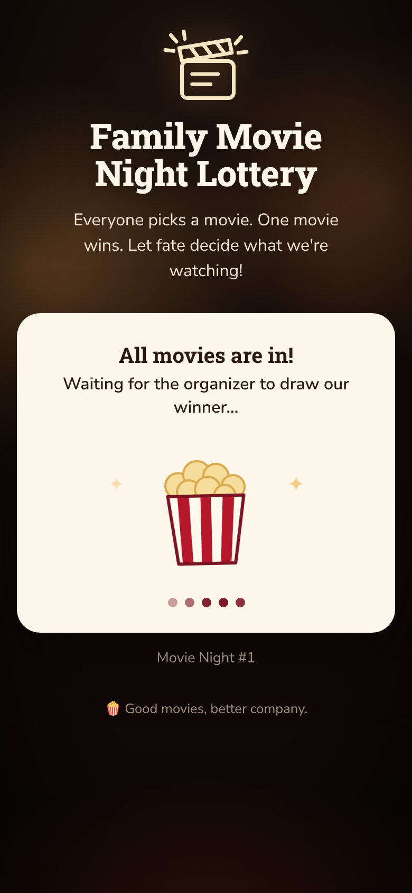
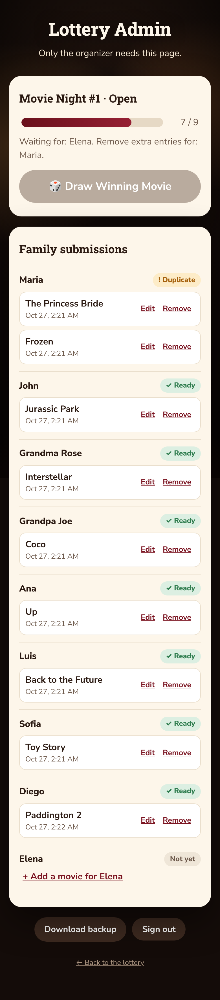

# 🎬 Family Movie Night Lottery

Everyone picks a movie. One movie wins. Let fate decide what we're watching!

Every family member submits one movie on the website. No accounts, no app. The organizer reviews the picks on a password-protected `/admin` dashboard, fixes any mistakes, and presses **Draw Winning Movie**. A cryptographically secure, unbiased random draw picks one of the movies. The result is saved permanently and shown on the main page.

It runs on a single **Cloudflare Worker** with a **SQLite-backed Durable Object** for storage, all on the Workers Free plan. **Workers Builds** deploys it from GitHub on every push.

| Accepting submissions | All movies in | Winner | Admin dashboard |
| --- | --- | --- | --- |
|  |  |  |  |

---

## Contents

1. [How it works](#1-how-it-works)
2. [Deploy from GitHub with Workers Builds](#2-deploy-from-github-with-workers-builds)
3. [Configuration](#3-configuration)
4. [Administrator guide](#4-administrator-guide)
5. [Changing the family members](#5-changing-the-family-members)
6. [Security and privacy](#6-security-and-privacy)
7. [Testing](#7-testing)
8. [Local development](#8-local-development)
9. [Free-tier budget](#9-free-tier-budget)
10. [Project layout](#10-project-layout)

---

## 1. How it works

```
 Family member's phone                 Cloudflare Worker (free plan)
 ─────────────────────                 ───────────────────────────────────────────────
  Main page  "/"                        GET  /api/status       public, no titles until the draw
   ├─ progress + who's in               POST /api/submit       { name, title }
   └─ form: Your Name, Movie Title ──►        │
                                              ▼
 Organizer                              Durable Object (one instance, SQLite)
 ─────────                               rounds · submissions · counters
  /admin (password) ─────────────────►  POST /api/admin/{login, add, edit, remove,
   ├─ every member + their picks                           restore, draw, new-round}
   ├─ duplicates highlighted            GET  /api/admin/{state, export}
   ├─ edit / remove / restore / add
   ├─ 🎲 Draw Winning Movie (enabled only when ready)
   └─ Start New Round
```

Nothing runs on a schedule. There's no polling and no automatic draw. The Worker only does anything when someone loads a page or clicks a button.

**Round lifecycle:** `Open` → (admin clicks Draw) → `Completed` → (admin clicks Start New Round) → a new `Open` round.

**Who counts:** a family member counts only when they have **exactly one** active submission in the current round.

* If someone submits twice, both entries are shown on the dashboard as **Duplicate** and that person doesn't count. The admin removes the extra one, and can restore it later.
* The **Draw Winning Movie** button is enabled only when every family member has exactly one active submission. The server checks this again when the button is pressed.

**The draw:**
* One click picks one of the submissions using `crypto.getRandomValues` with rejection sampling, so every movie has exactly the same chance (1 in 7 for a family of seven).
* The winner is written with a single compare-and-set update (`UPDATE rounds … WHERE status = 'Open' RETURNING`). Only the first request can draw, so double-clicks and two admins clicking at once still give one winner.
* After the draw, the round's submissions can't be changed and new submissions are refused.

**What the public sees:**
* While the round is open: how many people have submitted and who's still missing. Movie titles stay secret.
* Once everyone has a valid pick: "All movies are in! Waiting for the organizer to draw our winner…"
* After the draw: the winning movie, who submitted it, the date, and everyone's picks.

## 2. Deploy from GitHub with Workers Builds

You need a free Cloudflare account. No credit card is needed for the Workers Free plan.

1. **Fork or push this repository to GitHub.**
2. In the Cloudflare dashboard, go to **Workers & Pages → Create → Import a repository** and connect your GitHub account. Choose this repository.
3. Use these build settings:

   | Setting | Value |
   |---|---|
   | Project / Worker name | `family-movie-night-lottery` (must match `name` in `wrangler.toml`) |
   | Production branch | your default branch (for example `master` or `main`) |
   | Build command | *(leave empty)* |
   | Deploy command | `npx wrangler deploy` (the default) |
   | Root directory | `/` |

4. **Save and Deploy.** The first build creates the Worker and its Durable Object. Opening the site at this point shows a "Setup needed" message until step 5 is done.
5. Go to **Worker → Settings → Variables and Secrets** and add:

   | Name | Type | Value |
   |---|---|---|
   | `FAMILY_MEMBERS` | Text | One name per family member, comma-separated (2–30 names), for example `Jocelyne,Nino,Nina,…` |
   | `ADMIN_PASSWORD` | **Secret** | A long passphrase (12+ characters), for example four random words |

   Saving these applies them right away. No redeploy is needed.
6. Open `https://family-movie-night-lottery.<your-subdomain>.workers.dev`. That's the link to share with the family. Your dashboard is `/admin`.

From now on, every push to the production branch redeploys automatically. Cloudflare doesn't generate preview URLs for Workers that use Durable Objects, so you can switch off *Builds for non-production branches* under **Settings → Build**. Your data lives in the Durable Object and survives every redeploy. `wrangler.toml` sets `keep_vars = true`, so deploys never erase the dashboard variables.

> **Why the names aren't in `wrangler.toml`:** this repository is public. Keeping `FAMILY_MEMBERS` and the password in the dashboard keeps them out of git.

GitHub Actions (`.github/workflows/test.yml`) runs the tests and a dry-run build on every push and pull request.

## 3. Configuration

| Name | Where | Required | Purpose |
|---|---|---|---|
| `FAMILY_MEMBERS` | Dashboard variable (or `.dev.vars` locally) | ✅ | 2–30 unique, comma-separated names. Sets the family size and the form's name dropdown. |
| `ADMIN_PASSWORD` | Dashboard **secret** (or `.dev.vars` locally) | ✅ for `/admin` | The admin password, at least 12 characters. The public page works without it, but `/admin` stays locked until it's set. |

There's nothing else to configure: no API keys and no external services.

## 4. Administrator guide

Open **`/admin`** and sign in with `ADMIN_PASSWORD`. You stay signed in on that browser for 12 hours.

**While people are submitting** (it can take a couple of days):
* Every family member is listed with a badge: **✓ Ready**, **! Duplicate** or **Not yet**, plus their submissions and when they were sent.
* **Edit** fixes a typo in a movie title.
* **Remove** takes out an extra or wrong entry. Removed entries are listed under *Removed*, where you can **Restore** them.
* **+ Add a movie for …** enters a pick for someone who told you in person.
* If someone picked the wrong name, remove that entry and add it again under the right name.

**Drawing the winner:** when every member shows ✓ Ready, the **🎲 Draw Winning Movie** button turns on. Click it and confirm. The winner appears on the main page straight away. It's permanent and can't be redrawn.

**Next movie night:** click **Start New Round**. Progress resets to 0 and the previous winner moves to *Past winners*. Share the same link again.

**Backups:** **Download backup** saves every round and submission as JSON.

## 5. Changing the family members

1. In the Cloudflare dashboard, edit the `FAMILY_MEMBERS` variable. List each person once (2–30 names). The family size follows the list automatically: the draw needs one movie from each person.
2. Save. The change takes effect immediately.

It's best to change names between rounds. If you rename someone mid-round, their earlier entry appears on the dashboard under *Other names* and doesn't count. Add their movie again under the new name.

## 6. Security and privacy

* **The admin password is a Cloudflare secret.** It's never in the repository, the page or the browser. It's compared in constant time.
* **Signing in issues a session cookie** (`__Host-fmnl_admin`) with these protections:
  * The page's JavaScript can't read it (`HttpOnly`), it's only sent over HTTPS (`Secure`), and other sites can't send it (`SameSite=Strict`).
  * It's signed with HMAC-SHA-256 and expires after 12 hours.
  * The signing key mixes the password with a random per-installation secret, so changing the password signs out every session.
* **Login lockout:** 5 wrong passwords lock that visitor out for 15 minutes. Visitors are identified by a one-way hash of their IP; raw IPs are never stored.
* **CSRF:** every state-changing request must be a same-origin JSON `POST`. Browsers can't send those across sites without a CORS preflight, and the Worker never grants one.
* **Spam:** the form has a hidden honeypot field, and each visitor can submit at most 10 times per hour.
* **Privacy:** movie titles aren't public until the draw. Before that, the main page shows only first names and counts.
* **Hardening:** everything rendered on the pages is HTML-escaped. Responses send `nosniff`, `no-referrer`, `X-Frame-Options: DENY` and HSTS.
* **Not protected (by design):** anyone with the link can submit under any family member's name. The duplicate rule and your review before drawing are the safeguard.
* **Optional upgrade:** with a custom domain, you can also put `/admin` behind **Cloudflare Access** (free for up to 50 users) for email one-time-code login on top of the password. On the shared `workers.dev` hostname, Access would protect the whole Worker, including the public page.

## 7. Testing

```bash
npm install
npm test          # unit + scenario tests (node:test, no extra dependencies)
npm run check     # tests + a dry-run Worker build (what CI runs)
```

The tests run the real lottery code on `node:sqlite`, the same SQL as the Durable Object.

| Scenario | Expected | Test |
|---|---|---|
| 1. Eight submissions | Draw button disabled; a draw request is refused | `scenarios.test.js` › 1 |
| 2. Ninth submission | Draw enabled; nothing is drawn automatically; one click saves a winner; a second draw is refused | › 2 |
| 3. Duplicate, plus one member missing | Draw stays disabled until the admin removes the extra | › 3 |
| 4. Two draws at the same moment | Two separate DB connections race; exactly one winner is recorded | › 4, 4b |
| 5. Restart after the draw | Same winner; no more draws, submissions or edits | › 5 |
| 6. New round | Progress back to 0; old submissions excluded; previous winner kept | › 6 |
| 7. Bad input | Unknown names, blank or too-long titles rejected; names matched case-insensitively | › 7 |
| 8. Fairness | Rejection-sampling proof, a chi-square test on 180,000 draws, and 1,800 full rounds | › 8 |

`units.test.js` covers edit, remove, restore and add-on-behalf, the private dashboard, title secrecy, export, config validation, session signing and expiry, invalidation on password change, login lockout, and rate-limit windows.

## 8. Local development

```bash
cp .dev.vars.example .dev.vars   # set FAMILY_MEMBERS and ADMIN_PASSWORD
npm run dev                      # http://localhost:8787  (admin: /admin)
```

Local data is kept in `.wrangler/state` (git-ignored). Delete that folder to start fresh. Use `http://localhost`, not `127.0.0.1`, so the browser accepts the `Secure` admin cookie.

To deploy by hand instead of through Workers Builds, run `npx wrangler login` and then `npm run deploy`.

## 9. Free-tier budget

| Resource | Workers Free allowance | This app |
|---|---|---|
| Worker requests | 100,000 / day | A few hundred per movie night |
| Durable Object requests | 100,000 / day | One per page load or button click |
| Durable Object storage | 5 GB (SQLite) | A few KB per round |
| CPU time | 10 ms per request | Small SQL queries; HMAC and SHA-256 for admin requests |
| Cron triggers | 5 per account | **0** (none used) |
| Workers Builds | Included on the Free plan | One short build per push |

If any limit were ever reached, Cloudflare rejects requests until the daily reset. It never bills you on the Free plan.

## 10. Project layout

```
src/
  index.js        Worker: routes, CSRF checks, session cookie
  lottery-do.js   Durable Object: the single owner of all state
  lottery.js      Core logic: validation, duplicate rule, draw, rounds, views
  store.js        SQLite schema, compare-and-set draw, counters
  auth.js         Admin password, signed sessions, lockout
  random.js       Unbiased crypto random integer
  config.js       FAMILY_MEMBERS / ADMIN_PASSWORD validation
  ui.js           Main page and admin dashboard (plain HTML/CSS/JS)
test/             node:test suites
wrangler.toml     Worker + Durable Object config (no secrets, no names)
```

The only dependency is `wrangler`, the Cloudflare CLI, as a dev dependency. The runtime has none.
