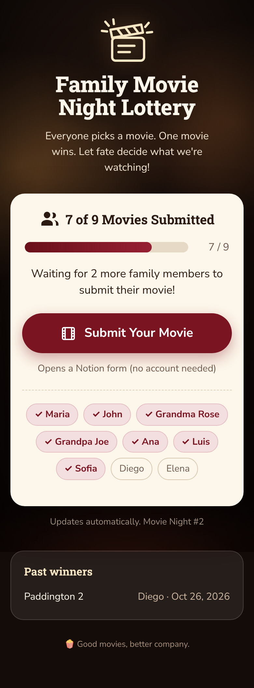
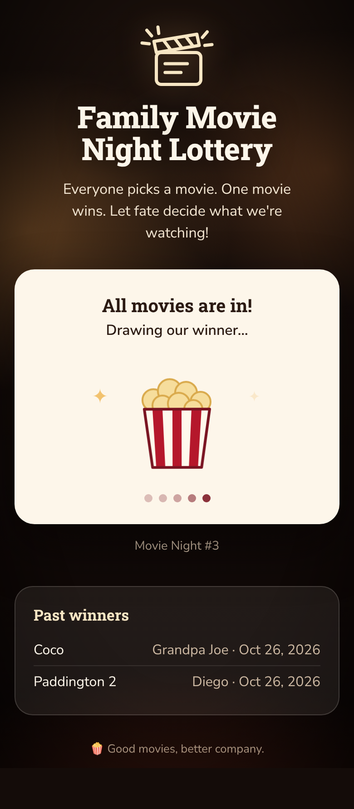
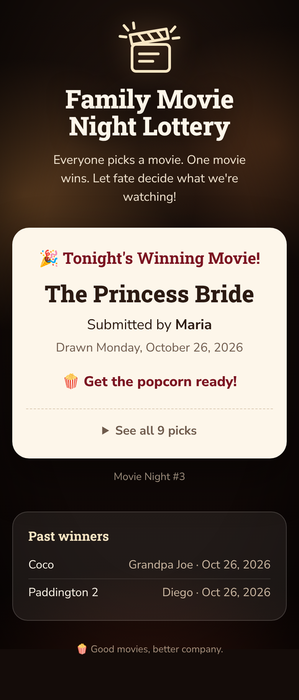

# 🎬 Family Movie Night Lottery

Everyone picks a movie. One movie wins. Let fate decide what we're watching!

Nine family members each submit one movie through a **Notion Form**. When the ninth valid submission arrives, a small **Cloudflare Worker** draws the winner automatically, using a cryptographically secure random number. The winner is posted on a cozy, mobile-friendly results page that anyone with the link can open. No sign-in, no app, and nothing to pay.

| Accepting submissions | Drawing | Winner |
| --- | --- | --- |
|  |  |  |

---

## Contents

1. [How it works](#1-how-it-works)
2. [Why this architecture](#2-why-this-architecture)
3. [Notion Forms: limits and how we handle them](#3-notion-forms-limits-and-how-we-handle-them)
4. [Setup: Notion databases](#4-setup-notion-databases)
5. [Setup: the Notion Form](#5-setup-the-notion-form)
6. [Setup: the Notion integration (API token)](#6-setup-the-notion-integration-api-token)
7. [Configuration](#7-configuration)
8. [Deployment](#8-deployment)
9. [Administrator guide](#9-administrator-guide)
10. [Changing the nine family members](#10-changing-the-nine-family-members)
11. [Testing](#11-testing)
12. [Security and privacy](#12-security-and-privacy)
13. [Free-tier budget](#13-free-tier-budget)
14. [Project layout](#14-project-layout)

---

## 1. How it works

```
 Family member's phone                         Cloudflare (free plan)
 ─────────────────────                         ────────────────────────────────────────────────
  "Submit Your Movie" ──► Notion Form           Worker  (src/index.js)
                              │                  ├─ GET /            results page (HTML)
                              ▼                  ├─ GET /api/status  public JSON (no titles until the reveal)
                     ┌───────────────────┐       ├─ /admin, /api/admin/*  token-protected
                     │ Notion database   │       └─ cron "* * * * *" ─┐
                     │ "Movie Submissions"│◄──── Notion API ──────────┤
                     └───────────────────┘   (read rows, write Status)│
                     ┌───────────────────┐                            ▼
                     │ Notion database   │◄──── result row ──  Durable Object (src/lottery-do.js)
                     │ "Lottery Rounds"  │                     SQLite: rounds, winner, progress
                     └───────────────────┘                     ← single source of truth
```

**How the form and the lottery communicate.** They don't talk to each other directly. The Notion Form writes each response as a new row in the *Movie Submissions* database. The Worker reads that database through the Notion API:

* **Every minute**, a Cloudflare cron trigger runs a check.
* **When someone opens the results page**, the page also starts a check, at most one every 15 seconds. If the family is watching, the ninth submission shows up within seconds.

Each check:

1. Loads the current round from the Durable Object's SQLite storage.
2. Queries Notion for rows in this round, plus new rows not yet assigned to any round.
3. Works out who counts, using the duplicate rules below.
4. If all nine members count, it **draws immediately**. It writes the winner with one atomic compare-and-set (`UPDATE … WHERE status = 'Open' RETURNING`). Only the first writer can succeed, so the lottery runs exactly once per round.
5. Writes bookkeeping back to Notion: the `Round` and `Status` of each row.

**Expected delay:** at most about 1 minute after the ninth valid submission, or a few seconds if someone has the page open. The page then shows *"All movies are in! Drawing our winner…"* for 20 seconds (configurable) before the reveal. The winner is already fixed and stored at that point. The API simply doesn't reveal it until the countdown ends.

**Round states:** `Open` → `Drawing` (winner stored, not yet shown) → `Completed` (winner shown and copied to Notion).

## 2. Why this architecture

I compared the options against current pricing and limits (October 2026):

| | **Cloudflare Worker + cron + Durable Object** ✅ | GitHub Actions (scheduled) | Notion webhooks |
|---|---|---|---|
| **Cost** | Free plan: 100k requests/day, 5 cron triggers, SQLite Durable Objects | Free for public repos (private repos: 2,000 min/month) | Free, but they still need a server to receive them |
| **Reliability** | Cron every minute; storage is transactional | Schedules are often delayed or dropped under load. **Turned off after 60 days without repo activity.** | Events are aggregated and may be delayed. You still need a fallback poll. |
| **Complexity** | One deploy. Pages, API, cron and state live in one place. | Still needs a separate state store (no locking) and separate hosting for the page | Public endpoint, verification handshake and signature checks, plus everything in the first column |
| **Maintenance** | None | Re-enable the workflow every 60 days | Re-verify the subscription when anything changes |
| **Detection speed** | ≤ 1 min (seconds while the page is open) | Minimum interval 5 min, often 10–30 min in practice | Usually under 1 min (`page.created` is batched) |
| **Free-tier limits** | 10 ms CPU per request; 50 outbound requests per invocation (we cap writes at 25 per check) | Minute quota; inactivity shutdown | Rate limit of about 3 requests/s for the API calls that follow each event |

**Decision:** One Cloudflare Worker gives the fastest detection that is still free, real locking, and a single free host for the page. Webhooks wouldn't make detection meaningfully faster than per-minute polling plus checks on page view, and they'd add a public endpoint to secure. They could be added later as an extra trigger for the same `check()`.

**Why a Durable Object as well as Notion?** Notion has no transactions or locks. The Durable Object is a single instance with transactional SQLite storage, which gives us:

* a winner recorded exactly once, through the atomic compare-and-set;
* a winner that can't change, because it's stored with a snapshot of all nine entries;
* storage that survives restarts and redeploys.

Notion is only the input (submissions) and an output mirror (results).

## 3. Notion Forms: limits and how we handle them

| Limitation | What we do |
|---|---|
| Public forms **don't verify who is submitting**. Picking "Maria" doesn't prove it's Maria. | The duplicate rule below. Two entries for the same name never count, so a mistake or a prank can't start the lottery. The admin decides. |
| You can't limit a public form to one response per person | Same rule: extra entries are flagged `Duplicate` until the admin resolves them |
| No custom HTML, CSS or JavaScript, so a form can't show progress | Progress and results live on the Worker's page. The form stays a plain, minimal Notion form. |
| No hidden or pre-filled fields, so the form can't record which round an entry belongs to | The Worker stamps each new row with the current round ID. Rows created before the round started are marked `Late`. |
| `created_time` is rounded down to the minute | A row counts for a round if it was created in the same minute the round started, or later |

### Duplicate and conflict rule

> A family member counts **only when they have exactly one submission in the current round that is not `Rejected`.**

* Maria submits *The Princess Bride*, then *Jurassic Park*. Both rows are marked `Duplicate`, and Maria shows as "needs attention". She doesn't count, so with eight others in, the lottery **doesn't** start.
* The admin sets `Status = Rejected` on the row that shouldn't count, or deletes it. On the next check the other row becomes `Counted`.
* The lottery starts only when nine **different** members each have exactly one counted movie.

Status values the Worker writes in Notion:

| Status | Meaning |
|---|---|
| `Counted` | This member's single valid pick for the round |
| `Duplicate` | This member has more than one entry; the admin must reject the extras |
| `Needs review` | The name isn't one of the nine, or the title is blank. It doesn't count. |
| `Rejected` | Set **by the admin**. The lottery ignores it and never overwrites it. |
| `Late` | Arrived between a draw and the next round. It isn't counted in any round. |
| `Winner` | The drawn movie |

Two family members picking the same movie is allowed. Each submission is one ticket.

## 4. Setup: Notion databases

Create a page called **Family Movie Night** (it can stay private). Inside it, create two databases. Property names must match exactly.

### Movie Submissions (required)

| Property | Type | Notes |
|---|---|---|
| `Movie Title` | Title | The default "Name" column, renamed |
| `Your Name` | Select | One option per family member, exactly matching `FAMILY_MEMBERS` |
| `Round` | Text | Filled in by the lottery. Leave it out of the form. |
| `Status` | Select | Options: `Counted`, `Duplicate`, `Needs review`, `Rejected`, `Late`, `Winner`. Leave it out of the form. |

> The API creates missing `Status` options automatically, but adding them yourself lets you pick colors. Suggested: Rejected = red, Duplicate = orange, Winner = yellow.

### Lottery Rounds (optional, recommended)

A permanent history of winners, filled in automatically after each draw.

| Property | Type |
|---|---|
| `Round` | Title |
| `Winning Movie` | Text |
| `Submitted By` | Text |
| `Lottery Date` | Date |

You can publish this database to the web (Share → Publish) as a second results page. It only ever contains completed rounds.

## 5. Setup: the Notion Form

1. Open **Movie Submissions** → **+ Add view** (or the `+` next to the views) → **Form**.
2. Title it *"Family Movie Night: pick your movie! 🍿"*.
3. Keep exactly two questions:
   * **Your Name** → property `Your Name`, **Required** ✅
   * **Movie Title** → property `Movie Title`, **Required** ✅
4. Don't add `Round` or `Status` to the form.
5. **Share form** → set access to **Anyone with the link** (people outside your workspace, no Notion account needed). Copy the link.
6. Paste the link into `NOTION_FORM_URL` in `wrangler.toml`.

**Reusing the same form every round is safe.** The form only creates rows. The Worker gives every new row the current round's ID. Rows from older rounds keep their own round ID and are never queried again. Anything submitted between a draw and the next round is marked `Late`. The form link never changes, and you can share the same link every movie night. You can also toggle the form's *Accepting responses* setting off between movie nights. That's optional.

## 6. Setup: the Notion integration (API token)

1. Go to <https://www.notion.so/profile/integrations> → **New integration**.
2. Type: **Internal**. Name: *Movie Night Lottery*. Pick your workspace.
3. **Capabilities:** *Read content* ✅, *Update content* ✅, *Insert content* ✅ (insert is needed for the Lottery Rounds rows). User information: **No user information**.
4. Copy the **Internal Integration Secret**. This is `NOTION_TOKEN`.
5. Give the integration access to **only** the two databases. On each one: **•••** → **Connections** → add *Movie Night Lottery*. Don't connect it to the whole workspace or to unrelated pages.
6. Copy each database's ID. Open the database as a full page and copy its link. The 32-character ID is part of it, and you can paste the whole URL into the config.

Check everything with:

```bash
npm install
echo "NOTION_TOKEN=ntn_your_secret" > .dev.vars
npm run notion:check                    # verifies access and property names/types
npm run notion:check -- --sync-members  # adds any missing family names to "Your Name"
```

The Worker uses Notion API version `2026-03-11`: data-source queries, and pages created with a `data_source_id` parent. Database IDs are resolved to their data source automatically.

## 7. Configuration

Public, non-secret settings go in `wrangler.toml` under `[vars]`:

| Variable | Example | Purpose |
|---|---|---|
| `FAMILY_MEMBERS` | `Maria,John,Grandma Rose,…` | **Exactly 9** comma-separated names (validated) |
| `NOTION_FORM_URL` | `https://yourname.notion.site/…` | Opened by the "Submit Your Movie" button |
| `NOTION_SUBMISSIONS_DB` | ID or URL | The database the form writes to |
| `NOTION_ROUNDS_DB` | ID or URL | Optional results database |
| `REVEAL_DELAY_SECONDS` | `20` | How long the "Drawing our winner…" screen shows |
| `NOTION_VERSION` | `2026-03-11` | Optional override of the Notion API version |

**Secrets** are never committed. They're stored encrypted by Cloudflare:

| Secret | How to set it |
|---|---|
| `NOTION_TOKEN` | `npx wrangler secret put NOTION_TOKEN` |
| `ADMIN_TOKEN` | `npx wrangler secret put ADMIN_TOKEN`. Use 16+ random characters, for example from `openssl rand -base64 24`. Admin is disabled if it's missing or shorter. |

For local development, put both in `.dev.vars` (git-ignored; see `.dev.vars.example`).

## 8. Deployment

You need Node.js 22.13+ and a free Cloudflare account (no credit card needed for the Workers Free plan).

```bash
git clone <this repo> && cd family-movie-night-lottery
npm install
npx wrangler login                       # opens the browser once
# edit wrangler.toml [vars]: names, form URL, database IDs
npx wrangler secret put NOTION_TOKEN
npx wrangler secret put ADMIN_TOKEN
npm test                                 # optional but recommended
npm run deploy
```

Wrangler prints your URL, for example `https://family-movie-night-lottery.<you>.workers.dev`. That's the link to share with the family. To redeploy after a change, run `npm run deploy` again. State in the Durable Object survives redeploys.

**Try it locally without Notion:**

```bash
npm run mock:notion        # terminal 1: fake Notion API on :8788
npm run dev:mock           # terminal 2: the Worker on http://localhost:8787
curl -X POST "http://127.0.0.1:8788/__fill?count=8"                      # 8 submissions
curl -X POST "http://127.0.0.1:8788/__submit?name=Elena&title=Up"        # the ninth
curl http://localhost:8787/__scheduled                                   # run the cron now
```

The local admin token for `dev:mock` is `local-admin-token-123`.

## 9. Administrator guide

The admin page is at **`/admin`**. Enter your `ADMIN_TOKEN`. It's kept only in that browser tab's session storage.

**During a round**
* See who's counted, who has duplicates, and who hasn't submitted.
* **Fix a duplicate:** in Notion, open *Movie Submissions* and find the member's rows marked `Duplicate`. Set the unwanted ones to `Rejected`, or delete them.
* **Replace someone's movie:** edit the row's `Movie Title` in Notion before the draw. To swap in a new submission instead, set the old row to `Rejected`.
* **Add a movie for someone without a phone:** add a row in Notion yourself with their name and title.
* **Check Notion now:** runs a check immediately instead of waiting for the next minute.

**You never draw the winner yourself.** It happens automatically on the first check after nine valid submissions.

**Start the next movie night**
1. Open `/admin` → **Start new round** (only enabled once the current round is *Completed*).
2. Progress resets to **0 of 9**. Earlier submissions keep their old round ID and never count again. Past winners remain on the page and in *Lottery Rounds*.
3. Share the same form link again.

The winner of a completed round can't be changed from the admin page or anywhere else. It's written once by a guarded database update and never modified.

## 10. Changing the nine family members

1. Edit `FAMILY_MEMBERS` in `wrangler.toml`. There must be exactly nine, with no duplicates. Spelling is matched case-insensitively.
2. Make the `Your Name` options in Notion match. `npm run notion:check -- --sync-members` adds new names. Remove old names in Notion yourself (the property's ••• → Edit property).
3. `npm run deploy`.

It's best to change names between rounds. A name removed mid-round no longer counts. That person's row shows `Needs review`.

## 11. Testing

```bash
npm test
```

The tests use only Node's built-in runner, `node:sqlite` (the same SQL as the Durable Object), and an in-memory fake of the Notion API. The real `NotionClient`, including retries, runs against that fake.

| Required scenario | Test |
|---|---|
| 1. Eight submissions → no winner | `scenarios.test.js` › 1 |
| 2. Ninth submission → automatic draw, winner hidden until the reveal, then mirrored to Notion | › 2 |
| 3. Duplicate + missing member → no draw; admin rejects the extra → draw | › 3 |
| 4. Concurrent processing: two separate connections to one SQLite file race, and exactly one winner is recorded once in Notion | › 4, 4b |
| 5. Restart after draw → same winner, even if Notion rows are edited afterwards | › 5 |
| 6. New round → 0 of 9, old and late submissions excluded, old winner kept | › 6 |
| 7. Notion outages: transient errors retried, sustained outage means no draw (then recovery), a failed later page never draws from partial data, failed result writes retried | › 7 |
| 8. Fairness: exact rejection-sampling proof, a chi-square test on 180,000 draws, and 1,800 full end-to-end rounds | › 8 |

`units.test.js` covers the duplicate rules, config validation, Notion client retry behavior, admin auth, the public API never leaking titles early, and the free-plan write cap.

**Fairness.** `secureRandomInt(9)` reads 32-bit values from `crypto.getRandomValues`. It rejects values at or above `2³² − (2³² mod 9)`, so each of the nine outcomes keeps exactly the same number of possible inputs. Every movie has a 1/9 ≈ 11.11% chance. (A plain `% 9` would be very slightly biased.)

## 12. Security and privacy

* **Secrets:** `NOTION_TOKEN` and `ADMIN_TOKEN` are Cloudflare secrets. They're never sent to the browser or committed. The front end only ever calls the Worker's own API.
* **Least privilege:** the integration is connected to the two databases only.
* **The submissions database stays private.** Family members never see it. The public API exposes only first names and counts while a round is open. **Movie titles appear only after the winner is revealed.**
* **Admin actions** (`/api/admin/*`) need `Authorization: Bearer <ADMIN_TOKEN>`. The comparison is constant-time, using SHA-256 digests. Admin is turned off entirely unless a token of 16+ characters is configured.
* Everything rendered on the page is HTML-escaped. Responses send `nosniff`, `no-referrer` and `X-Frame-Options: DENY`.
* **Not protected (by design):** anyone with the form link can submit under any name. The duplicate rule and the admin review are the safeguard.

## 13. Free-tier budget

| Resource | Free allowance | This app |
|---|---|---|
| Worker requests | 100,000/day | 1,440 cron runs + page views and polls (about 6/min per open tab) |
| Cron triggers | 5 per account | 1 |
| CPU time | 10 ms per invocation | Small JSON and SQL work; Notion wait time doesn't count as CPU |
| Outbound requests | 50 per invocation | ≤ 2 queries + ≤ 25 writes per check (larger backlogs continue next check) |
| Durable Objects (SQLite) | 100,000 requests/day, 5 GB | About 1,440 cron calls + page views; a few KB per round |
| Notion API | About 3 requests/s average | About 1 query/min, plus writes only when something changes |

Once a round is completed, cron checks don't call Notion at all until the next round starts.

## 14. Project layout

```
src/
  index.js        Worker: routes, admin auth, cron handler
  lottery-do.js   Durable Object wrapper (single instance → serialized)
  lottery.js      Core logic: duplicate rules, the draw, reveal, Notion sync
  store.js        SQLite schema and the compare-and-set draw
  notion.js       Minimal Notion API client with retry/backoff
  random.js       Unbiased crypto random integer
  config.js       Environment parsing and validation; Notion property names
  auth.js         Admin token check
  ui.js           Results page and admin page (plain HTML/CSS/JS)
scripts/
  notion-check.mjs   Validate Notion setup; sync family names
  mock-notion.mjs    Local fake Notion API for trying the app
test/                node:test suites + fake Notion
wrangler.toml        Worker, cron, Durable Object, [vars]
```

The only dependency is `wrangler`, the Cloudflare CLI, as a dev dependency. The runtime has none.
